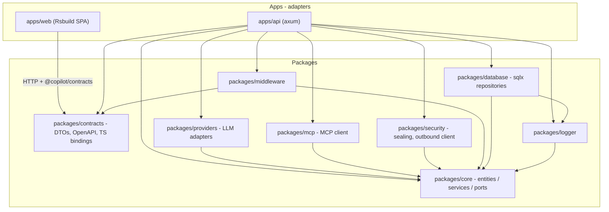

# ADR-001: Domain-Driven Design and Clean Architecture

## Status

Accepted

## Context

This repository is a starter template used to bootstrap new full-stack projects. Even though it ships with only health-check endpoints, every project that grows out of it should share the same architecture so engineers can move between codebases without re-learning where logic lives.

We follow a clean / domain-driven layering where business logic is independent of frameworks (axum, Rsbuild) and infrastructure (sqlx, Postgres). Dependencies point inward: adapters depend on the domain, never the reverse.

## Decision

We use the following layers and dependency direction:

- **`packages/core`**: the domain. Entities enforce invariants; application services orchestrate use cases; repository *traits* (ports) describe persistence needs. No framework or database crates.
- **`packages/database`**: infrastructure. Implements the repository traits with sqlx, owns migrations, seed, and the readonly role.
- **`packages/contracts`**: transport DTOs shared by the API (serialization, OpenAPI) and the web app (generated TypeScript types plus Zod schemas). See [ADR-004](./004-contracts-and-type-sharing.md).
- **`packages/middleware`, `packages/logger`**: cross-cutting adapters that depend on core's ports and types.
- **`packages/providers`, `packages/mcp`, `packages/security`**: outbound adapters that implement core ports (`LlmGateway`, `ToolHost`, `SecretCipher`). They share the outbound HTTP client that the composition root builds with `copilot-security`, and never depend on each other, the database, contracts, or HTTP server crates.
- **`apps/api`**: HTTP adapter. The composition root wires dependencies; routes map requests to services; middleware translates domain errors to HTTP responses.
- **`apps/web`**: UI adapter. Talks to the API over HTTP and reuses the contract schemas.

The rules are enforced by Cargo (a crate only sees what its `Cargo.toml` lists) and by `make boundaries`, which checks that those lists never cross a forbidden edge.

### How to Add a Domain End to End

Suppose you are adding a `Widget` domain (the `/add-domain` skill has the detailed checklist):

1. **Entity**: `packages/core/src/domains/widget/entities.rs`, the `Widget` type with construction rules and behaviour.
2. **Repository port**: `packages/core/src/domains/widget/ports.rs`, an `async_trait` (`get`, `list`, `save`, `delete`).
3. **Service**: `packages/core/src/domains/widget/service.rs`, use cases over `Arc<dyn WidgetRepository>`.
4. **Domain barrel**: `packages/core/src/domains/widget/mod.rs`, then re-export from `packages/core/src/lib.rs`.
5. **Migration**: `make migrations name=create_widgets`, write the SQL, and apply it with `make migrate` (ADR-002; never edit a migration a shared or deployed database has applied).
6. **Repository implementation**: `impl WidgetRepository for PgStore` in `packages/database/src/repositories/widgets.rs` (one store, one module per port, declared in `repositories/mod.rs`), mapping driver errors with `store::failed` and stored values with `store::invalid`.
7. **Contract**: `packages/contracts/src/widget.rs` DTOs, `make contracts`, and Zod schemas in `packages/contracts/ts/index.ts`.
8. **API route**: `apps/api/src/routes/widgets.rs` with `#[utoipa::path]` handlers, merged in `routes/mod.rs`; the service is built in the composition root and stored in `AppState`.
9. **Web**: `apps/web/src/api/routes/widgets.ts` for the typed client and a page under `apps/web/src/routes/widgets/`.

## Consequences

### Positive

- Consistent structure across every project bootstrapped from this template.
- Business logic is unit-testable without a database or HTTP server.
- Swapping infrastructure (a different database driver or auth provider) is localized to adapter crates.

### Negative

- More crates, files, and indirection up front for small features.
- Async repository traits need `async_trait` (boxed futures) to be used behind `Arc<dyn Trait>`.

### Neutral

- The template ships health-only apps; the structure exists before the first real domain, by design.
- API shapes are defined separately from domain entities and mapped at the boundary.

## References

- [ADR-003: Rust Backend Stack](./003-rust-backend-stack.md)
- [ADR-004: Contracts and Type Sharing](./004-contracts-and-type-sharing.md)
- [Cargo workspaces](https://doc.rust-lang.org/cargo/reference/workspaces.html)
- [pnpm workspaces](https://pnpm.io/workspaces)
