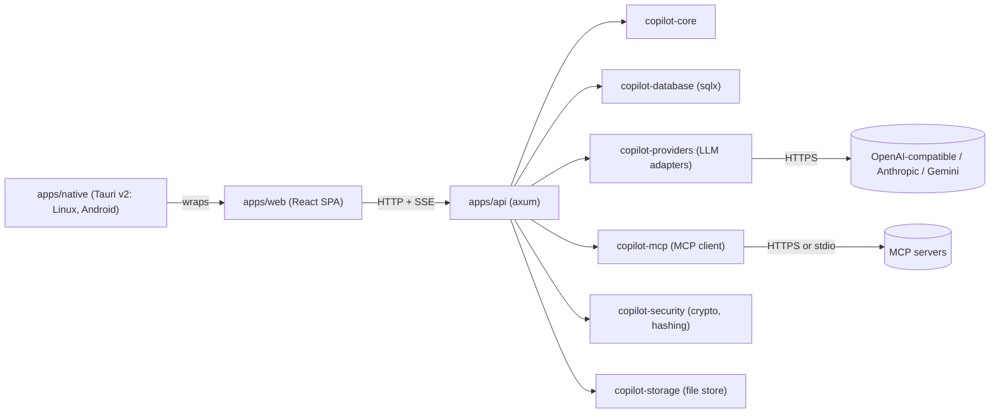

# Copilot Product and Architecture Design

Status: draft v1 (2026-11-26). This is the working spec for the first release. ADRs record the decisions that come out of it.

## Goal

A lightweight, self-hosted chat client for any model provider. The backend stores users, chats, projects, tool server settings, and schedules. It **forwards** every model request to a provider and never runs a model itself.

### Hard Constraints

1. **No in-process ML.** No local speech-to-text, text-to-speech, embeddings, or inference. No Python, CUDA, or PyTorch anywhere in the build. If a provider does not support a capability, Copilot does not fake it.
2. **Small footprint.** One Rust API binary, Postgres, and a static web bundle. Native apps wrap the same web bundle with Tauri v2.
3. **Clean/DDD layering** from the template (ADR-001). Domain logic lives in `copilot-core`; adapters implement its ports.
4. **Clients:** web, Linux desktop, and Android first. Windows and macOS come from the same Tauri project later.

### Non-Goals for v1

- Retrieval-augmented generation (RAG) and vector search. Project files go to the model as context (long context windows make this practical). A later version can add provider-hosted embeddings plus `pgvector`.
- Running code or plugins inside Copilot. Tools come from MCP servers.
- Branching conversation trees. Editing a message truncates the conversation after it and regenerates.

## Concepts and UX

The owner asked for four capabilities. The design maps them to three user-facing concepts.

| Need | Concept |
| --- | --- |
| Store a set of files and start many sessions with them | **Project** files |
| Reuse a system prompt for many sessions ("agents") | **Project** instructions |
| Chat with any model, with or without a project | **Chat** |
| Run a prompt at a set time | **Schedule** (belongs to a project or stands alone) |
| Call external systems | **Tools** (MCP servers), enabled per project or per chat |

### Projects Replace "Agents"

A project is a reusable context: **name, instructions (system prompt), files, default model, enabled tools, and schedules.** Every chat created in a project inherits all of them. A prompt-only "agent" is a project with no files. This keeps one concept instead of two, and matches what users know from other chat apps.

- **Instructions** are the project's system prompt.
- A chat can add its own **chat instructions**, appended after the project's. Standalone chats use this as their system prompt.
- **Save as project:** from any chat with chat instructions or attachments, one action creates a project from them, so a good prompt becomes reusable without retyping.

### Schedules

A schedule runs a prompt on a cron expression in a time zone. Each firing creates a new chat in the schedule's project (titled `<schedule name> · <local date>`) and runs the prompt unattended, or appends to one fixed chat when the user chooses "continue the same chat".

- The **system clock** fires schedules. A background scheduler in the API process claims due rows with `FOR UPDATE SKIP LOCKED` and computes the next fire time with a cron library. The model never decides when a run happens at run time.
- The **model may create schedules** through a built-in tool (`schedule_prompt`, plus `list_schedules` and `cancel_schedule`) when the project or chat enables "Let the assistant manage schedules". The tool validates the cron expression and only writes a row; the scheduler does the rest. Schedules the assistant created are marked as such in the UI.
- Unattended runs only call tools from servers marked "run without asking".

### Tools (MCP Servers)

Users register MCP servers in Settings (name, URL, optional headers or bearer token, approval mode). A project enables a subset; a standalone chat picks tools from the composer's tools menu.

- **Approval mode** per server: `auto` (run tool calls immediately) or `ask` (the chat pauses and shows Approve / Deny on the tool call card). Unattended schedule runs deny `ask` tools with a message to the model.
- Transport: streamable HTTP for remote servers. Local stdio servers (a command the API host spawns) are off unless the operator sets `MCP_STDIO_ENABLED=true`, because they run processes on the server.
- Built-in tools (the schedule tools) use the same tool interface as MCP tools.

### Providers and Models

Settings has a **Providers** page. A provider connection has a kind, a name, a base URL, and an API key (encrypted at rest).

| Kind | Covers |
| --- | --- |
| `openai` (OpenAI-compatible Chat Completions) | OpenAI, Ollama (`/v1`), vLLM, LM Studio, llama.cpp server, OpenRouter, Groq, Together, any compatible gateway |
| `anthropic` (Messages API) | Anthropic and compatible gateways |
| `gemini` (Generative Language API) | Google Gemini |

After saving, Copilot lists the provider's models. The user **enables** the models they want in the model picker. Each enabled model carries **capability flags** (vision, PDF input, tool use, audio input, audio output, reasoning) with defaults per provider kind and known model families, which the user can override. The UI only offers attachments, tools, or voice when the selected model's flags allow it. Presets fill in base URLs for OpenAI, Anthropic, Gemini, Ollama, and OpenRouter.

### Voice

Voice follows constraint 1: Copilot forwards audio only to providers whose API accepts or produces audio natively. See `docs/research/voice.md` for the provider survey this section depends on.

- **Audio in (push to talk):** the composer shows a microphone button only when the selected model has the `audio_in` flag. The client records with `MediaRecorder` and sends the clip as an audio part of the user message; the API forwards it in the provider's native audio format.
- **Audio out (read aloud):** a speaker button on assistant messages appears only when the model has `audio_out`, or when the provider exposes a speech endpoint for the connection. No local TTS engine ships with Copilot.
- Anthropic: see the research note for what the API supports today; Copilot does not add a translation layer for it.

### Chat Experience

- Sidebar: New chat, search, Projects, recent chats grouped by day, user menu with Settings. On narrow screens the sidebar is a drawer.
- Chat header: title (editable), project badge, model picker, tools menu, chat settings drawer (chat instructions, attachments).
- Messages: streamed Markdown with code blocks and copy buttons, collapsible reasoning summaries when the provider returns them, tool call cards (name, arguments, result, status, approve or deny), error banners with retry.
- Composer: auto-growing text area, attach files (shown when the model accepts them), microphone (when `audio_in`), send, and stop while generating.
- Actions: stop, regenerate last answer, edit the last user message and resend, copy, delete chat, rename, move to project.
- Generation keeps running if the client disconnects (mobile networks drop). The client reattaches to the live stream or reads the finished message.
- Native apps ask for the server URL on first launch and remember it.

## Architecture

### Crates

| Crate | Role | Implements |
| --- | --- | --- |
| `copilot-core` | Entities, services, ports, the conversation engine, the cron rule | none |
| `copilot-database` | sqlx repositories | repository ports |
| `copilot-providers` | OpenAI-compatible, Anthropic, and Gemini wire protocols over reqwest with SSE parsing | `LlmGateway` |
| `copilot-mcp` | MCP client (streamable HTTP, optional stdio) | `ToolHost` for MCP servers |
| `copilot-security` | AES-256-GCM secret sealing, Argon2id password hashing, random token generation and hashing | `SecretCipher`, `PasswordHasher`, `TokenIssuer` |
| `copilot-storage` | Local disk file store under `DATA_DIR` | `FileStore` |
| `copilot-contracts` | DTOs and the chat stream event union | none |
| `copilot-middleware` | Auth guard backed by `TokenVerifier`, CORS, errors | none |
| `apps/api` | Composition root, routes, run registry, scheduler loop | none |

`copilot-core` may depend on small pure libraries (`uuid`, `chrono`, `chrono-tz`, a cron parser, `futures`). The boundary rules for the new crates: adapters may depend on `copilot-core` and their own I/O libraries, never on `copilot-database`, `copilot-api`, `axum`, or each other.

### Core Domains

| Domain | Entities | Ports |
| --- | --- | --- |
| `identity` | `User`, `AuthSession` | `UserRepository`, `AuthSessionRepository`, `PasswordHasher`, `TokenIssuer` |
| `provider` | `ProviderConnection`, `Model`, `Capabilities` | `ProviderRepository`, `ModelRepository`, `SecretCipher`, `LlmGateway` (list models, stream chat) |
| `project` | `Project` | `ProjectRepository` |
| `file` | `StoredFile` | `FileRepository`, `FileStore` |
| `chat` | `Chat`, `Message`, `Part` (text, file, audio, tool call, tool result, reasoning) | `ChatRepository`, `MessageRepository` |
| `tool` | `ToolServer` (MCP registration), `ToolSpec`, `ToolCall`, `ToolOutput` | `ToolServerRepository`, `ToolHost` |
| `schedule` | `Schedule`, `ScheduleRun`, `CronRule` | `ScheduleRepository`, `Clock` |

### Conversation Engine

`ChatEngine` in `copilot-core` runs one assistant turn and yields `ChatEvent`s:

1. Load the chat, its project, the model, and the provider. Decrypt the API key through `SecretCipher`.
2. Build a provider-neutral `LlmRequest`: system prompt (project instructions, then chat instructions, then a short note on built-in tools when enabled), the message history as parts, project files and attachments as parts the model's capabilities allow (text files inline as text, PDFs and images as native parts, others skipped with a notice), and tool specs from the enabled servers.
3. Stream from `LlmGateway`. Forward text and reasoning deltas as events.
4. When the model requests tools, run them through `ToolHost` (per-call timeout, result size cap, approval gate), emit events, append results, and continue. Stop after a maximum number of tool rounds.
5. Persist each assistant message and tool result as it completes. On cancel or error, persist what exists with status `cancelled` or `error`.

The API runs each turn in a spawned task registered in a `RunRegistry` (chat id to broadcast channel plus cancellation token). HTTP clients subscribe; disconnecting does not cancel; `POST /chats/{id}/stop` does. Scheduled runs call the same engine with no subscriber.

### Stream Events (SSE)

`POST /chats/{id}/messages` responds with `text/event-stream`. Each event's `data` is one JSON `ChatEvent` (tagged by `type`) from `copilot-contracts`:

| `type` | Payload |
| --- | --- |
| `message.started` | `messageId`, `role` |
| `text.delta` | `messageId`, `text` |
| `reasoning.delta` | `messageId`, `text` |
| `tool.requested` | `messageId`, `callId`, `name`, `server`, `arguments`, `needsApproval` |
| `tool.finished` | `callId`, `status` (`ok`, `error`, `denied`), `output` (truncated for display) |
| `message.finished` | `messageId`, `status`, `usage` |
| `error` | `message`, `code` |
| `done` | none |

`GET /chats/{id}/stream` reattaches to a live run (replays the current message so far, then live events) or returns `204` when idle.

### HTTP API (v1)

All routes except auth and health need `Authorization: Bearer <token>`. Lists use `ListResponse`, single items `DetailsResponse`.

| Area | Routes |
| --- | --- |
| Auth | `POST /auth/register` (first user becomes admin; later users only when registration is open), `POST /auth/login`, `POST /auth/logout`, `GET /auth/me` |
| Providers | `GET/POST /providers`, `GET/PATCH/DELETE /providers/{id}`, `POST /providers/{id}/refresh` (list remote models) |
| Models | `GET /models` (enabled models for the picker), `GET /providers/{id}/models` (all known), `PATCH /models/{id}` (enable, rename, capability overrides) |
| Projects | `GET/POST /projects`, `GET/PATCH/DELETE /projects/{id}` |
| Files | `POST /projects/{id}/files` (multipart), `GET /projects/{id}/files`, `POST /chats/{id}/files`, `GET /files/{id}/content`, `DELETE /files/{id}` |
| Chats | `GET/POST /chats` (filter by project, search by title), `GET/PATCH/DELETE /chats/{id}`, `GET /chats/{id}/messages`, `POST /chats/{id}/messages` (SSE), `GET /chats/{id}/stream`, `POST /chats/{id}/stop`, `POST /chats/{id}/regenerate` (SSE), `POST /chats/{id}/tool-calls/{callId}/decision` |
| Tools | `GET/POST /tool-servers`, `GET/PATCH/DELETE /tool-servers/{id}`, `POST /tool-servers/{id}/test` (connect and list tools) |
| Schedules | `GET/POST /schedules`, `GET/PATCH/DELETE /schedules/{id}`, `POST /schedules/{id}/run` (run now), `GET /schedules/{id}/runs` |

### Data Model (Postgres)

Owner-scoped tables carry `user_id` and every query filters by it. Column order follows `postgres-column-alignment`.

| Table | Key columns |
| --- | --- |
| `users` | `id`, `username` (unique, case-insensitive), `password_hash`, `display_name`, `is_admin` |
| `auth_sessions` | `id`, `user_id`, `token_hash` (SHA-256, unique), `expires_at`, `last_used_at`, `user_agent` |
| `providers` | `id`, `user_id`, `kind`, `name`, `base_url`, `api_key_sealed` (nullable), `enabled` |
| `models` | `id`, `provider_id`, `remote_id`, `display_name`, `enabled`, `capabilities` (jsonb), `context_window` |
| `projects` | `id`, `user_id`, `name`, `instructions`, `default_model_id`, `manage_schedules` |
| `files` | `id`, `user_id`, `project_id` or `chat_id`, `name`, `media_type`, `size_bytes`, `sha256`, `storage_key` |
| `chats` | `id`, `user_id`, `project_id`, `model_id`, `title`, `instructions`, `schedule_id`, `manage_schedules`, `pinned` |
| `messages` | `id`, `chat_id`, `role`, `parts` (jsonb), `status`, `model_id`, `usage` (jsonb), `error` |
| `tool_servers` | `id`, `user_id`, `name`, `transport`, `url`, `command`, `headers_sealed`, `approval`, `enabled` |
| `project_tool_servers`, `chat_tool_servers` | join tables with cascade deletes |
| `schedules` | `id`, `user_id`, `project_id`, `model_id`, `name`, `cron`, `timezone`, `prompt`, `mode` (`new_chat`, `same_chat`), `target_chat_id`, `enabled`, `next_run_at`, `last_run_at`, `created_by` (`user`, `assistant`) |
| `schedule_runs` | `id`, `schedule_id`, `chat_id`, `started_at`, `finished_at`, `status`, `error` |

### Security

- Passwords: Argon2id. Tokens: 32 random bytes, sent once, stored as SHA-256. Sessions expire (default 30 days, sliding).
- Secrets (provider keys, tool server headers): AES-256-GCM with `SECRET_KEY` (32 bytes, base64) from the environment. Responses never include secrets, only whether one is set.
- User-supplied URLs (providers, tool servers) are fetched by the server. `ALLOW_PRIVATE_NETWORK` (default true for self-hosting, since Ollama usually runs on the LAN) can be turned off to block private and loopback ranges.
- Upload limits: `MAX_UPLOAD_MB` (default 25). Files are stored by random key, never by the user's file name.
- Markdown renders without raw HTML. Strict CSP on the web bundle.

### Configuration (new environment variables)

| Variable | Default | Purpose |
| --- | --- | --- |
| `SECRET_KEY` | required outside `local` | 32-byte base64 key for sealing secrets |
| `DATA_DIR` | `./data` | File storage root |
| `REGISTRATION_OPEN` | `false` | Allow sign-ups after the first (admin) user |
| `SESSION_TTL_DAYS` | `30` | Token lifetime |
| `MAX_UPLOAD_MB` | `25` | Per-file upload limit |
| `MCP_STDIO_ENABLED` | `false` | Allow stdio MCP servers |
| `SCHEDULER_ENABLED` | `true` (server binary) | Run the schedule loop |
| `ALLOW_PRIVATE_NETWORK` | `true` | Allow provider and tool URLs on private networks |

### Native Apps

`apps/native` is a Tauri v2 project that bundles the production web build. On first launch it shows a server URL screen; the URL is stored on the device. The API's CORS list includes the Tauri webview origins. Android needs `INTERNET` and, for voice, `RECORD_AUDIO`. See `docs/research/native-and-ci.md`.

### CI

Each job uses the smallest GitHub-hosted runner that can finish it (see the research note for the current runner catalog): lint-only jobs on the slim runner, Rust test and build jobs on the standard Linux runner, the Android build on the standard Linux runner, and macOS runners only for macOS or iOS bundles.
